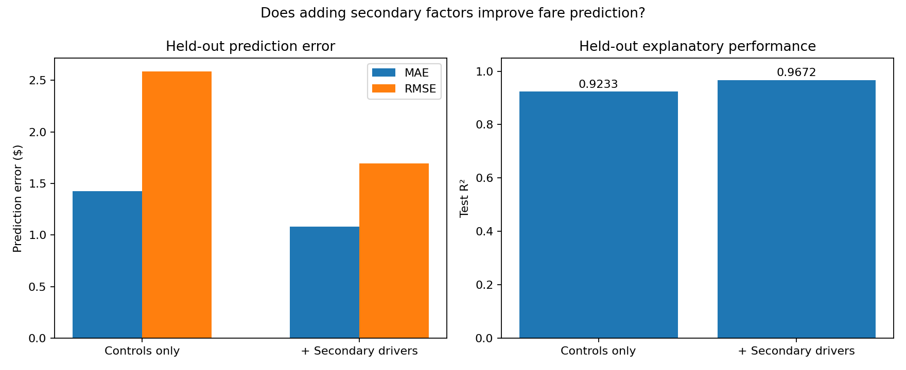
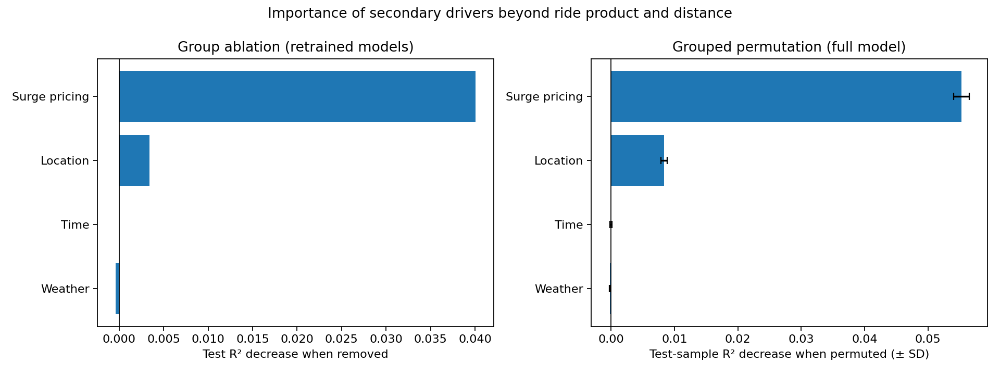
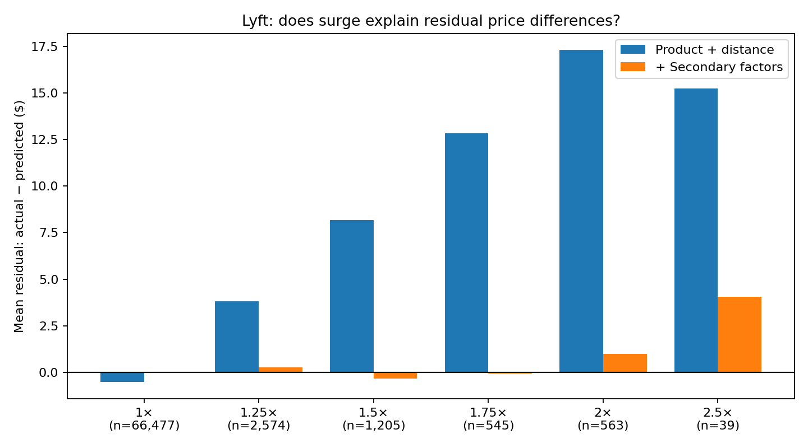
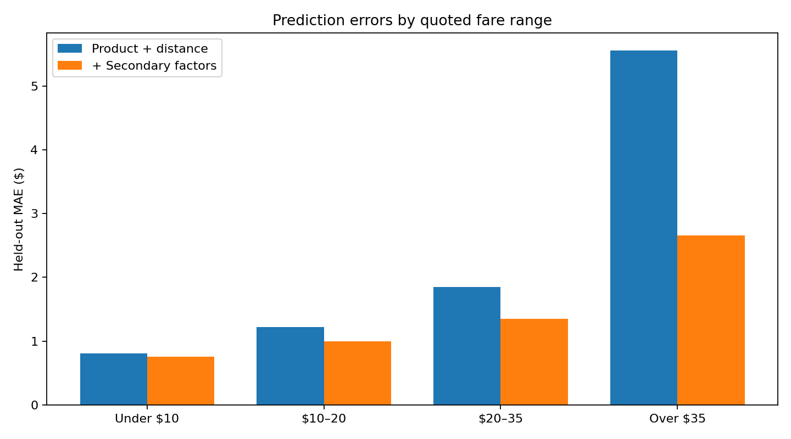

# Secondary Drivers of Uber and Lyft Ride Prices

## A Conditional Key Driver Analysis of Boston Rideshare Fare Quotes

## Abstract

An earlier key driver analysis of historical Boston Uber and Lyft fare quotes identified **ride product** and **trip distance** as the dominant predictors of price. This follow-up asks whether other recorded factors provide meaningful information once those two variables are already accounted for. Using 637,976 cleaned fare-quote observations, I compared a Random Forest model based on product and distance with an expanded model that also included recorded surge multiplier, pickup and drop-off locations, time, and weather conditions. Both were trained on the same 200,000 quotes and evaluated on the same chronologically held-out observations. The expanded model improved test R² from **0.9233 to 0.9672** and reduced mean squared prediction error by **57.25% relative to the baseline**. Leave-one-group-out ablation and permutation analyses identified recorded **surge pricing** as the main source of the incremental improvement; location added a small amount, while weather and time added negligible predictive value. Residual diagnostics showed that improvements were concentrated in Lyft quotes, particularly those with surge multipliers above 1. These results describe **predictive associations**, not causal effects or the complete pricing mechanisms of either platform.

## 1. Research Question and Motivation

**Research question:** *After accounting for ride product and trip distance, which additional factors explain the remaining variation in rideshare prices, and how important are their contributions?*

Ride product and distance are central to fare determination, so a conventional importance ranking can be dominated by these features. Rather than exclude them and risk allowing other variables to act as proxies, this study **retains product and distance as controls** and evaluates the *additional predictive value* of other available variables. The goal is not to claim that the remaining predictors independently cause fare changes, but to identify which ones improve predictions beyond a strong, interpretable benchmark.

## 2. Data and Preparation

The data come from the [Uber and Lyft Dataset: Boston, MA on Kaggle](https://www.kaggle.com/datasets/brllrb/uber-and-lyft-dataset-boston-ma?resource=download), containing historical fare quotes from November 25 to December 18, 2018 (Boston local time). The same SQL preprocessing logic used in the original project was reused here rather than repeating exploratory data analysis.

The preprocessing script (`src/preprocessing.sql`) reads the raw CSV, converts relevant fields to the expected types, excludes rows with missing or invalid required values, deduplicates by ride ID, and derives Boston-local date, hour, and weekday fields. It writes `data/rideshare_model.csv`; the raw input remains unchanged.

| Dataset summary | Observations |
| --- | ---: |
| Cleaned fare quotes | 637,976 |
| Quotes dated before the test period | 489,252 |
| Chronologically held-out test quotes | 148,724 |
| Test period begins | December 15, 2018 |

The analysis uses the following predictors:

| Role | Variables |
| --- | --- |
| Outcome | `price` |
| Controls (always retained) | `name` (ride product), `distance` |
| Surge pricing | `surge_multiplier` |
| Location | `source`, `destination` |
| Time | `local_hour`, `weekday` |
| Weather | `temperature`, `precipIntensity`, `windSpeed` |

The SQL output also retains `cab_type` so model errors can be compared between Uber and Lyft. The models encode categorical variables using one-hot encoding and use a Random Forest regressor to allow nonlinear relationships and interactions. The expanded model here uses the same specification, training sample, and random seed as the main forest in the original project, and reproduces its held-out metrics exactly, so the two reports describe one model.

## 3. Methodology

### 3.1 Baseline versus expanded prediction models

Two models were trained on **the same random sample of 200,000 quotes** drawn from the pre-test period and evaluated on the same 148,724 held-out quotes:

- **Baseline:** ride product + distance.
- **Expanded:** ride product + distance + surge multiplier + location + time + weather.

Both models used 100 trees, maximum tree depth 20, minimum leaf size 5, half of the features considered at each split, and random seed 42. The held-out period was determined from the last approximately 20% of distinct dates. Results are reported using mean absolute error (MAE), root mean squared error (RMSE), and R².

The reduction in the baseline's held-out squared prediction error is computed as:

$$
\text{Relative MSE reduction} = \frac{\text{MSE}_{\text{baseline}}-\text{MSE}_{\text{expanded}}}{\text{MSE}_{\text{baseline}}}\times 100\%.
$$

This measures improvement in predictive accuracy. It is **not** the fraction of ride prices caused by the additional variables.

### 3.2 Conditional key driver importance

To identify which *groups* of secondary variables matter beyond the controls, a separate analysis fit an all-driver model and four versions that each omitted one secondary group. The drop in held-out R² after omitting a group measures its incremental value *given the other included predictors*. A complementary grouped permutation test shuffled each group's columns together in the fitted full model on 5,000 held-out quotes with 10 repeats, while leaving `name` and `distance` unchanged. Individual secondary variables were also ranked using permutation importance with the same settings.

For computational efficiency, this second analysis used **50,000 training quotes and 40 trees**, consistently across all compared models; it retained the same chronological test period. Therefore its absolute metrics differ slightly from the 200,000-row, 100-tree baseline comparison. Ablation and permutation scores are distinct quantities and should not be added or interpreted as percentage shares.

### 3.3 Held-out residual diagnostics

The **held-out residuals** of the 200,000-row baseline and expanded models were analyzed by platform, actual fare range, and recorded Lyft surge level. Residuals are defined as `actual price − predicted price`; a positive mean residual indicates underprediction. The predictions are those saved by the baseline comparison, so the diagnostics describe exactly the models reported in Section 4.1. This is a diagnostic comparison of model errors, **not** a separate causal or out-of-fold residual-modeling experiment.

## 4. Results

### 4.1 Do secondary factors add predictive information?

| Held-out metric | Product + distance | Expanded model |
| --- | ---: | ---: |
| R² | 0.9233 | **0.9672** |
| MAE | $1.4245 | **$1.0805** |
| RMSE | $2.5880 | **$1.6921** |
| MSE | 6.6979 | **2.8633** |

Adding secondary variables increased test R² by **0.0439**, reduced MAE by approximately **$0.34**, and reduced the baseline's held-out MSE by **57.25%**. Product and distance alone were already strong predictors, but they did not capture all the useful information in the available dataset.



### 4.2 Which secondary drivers contribute most?

The 50,000-row ablation analysis reported the following changes when each secondary group was removed from the all-driver model while **retaining ride product, distance, and the other secondary groups**:

| Omitted group | Decrease in test R² | Increase in MAE |
| --- | ---: | ---: |
| **Surge pricing** | **0.0401** | **$0.2833** |
| Location | 0.0034 | $0.0796 |
| Time | 0.0000 | $0.0012 |
| Weather | −0.0004 | −$0.0122 |

Removing surge pricing decreased R² from approximately **0.9646 to 0.9246**, close to the product-and-distance-only benchmark (R² = 0.9200 in this smaller-model experiment). Removing location caused a small deterioration; removing time changed nothing measurable, and removing weather slightly improved measured performance. These minor negative ablation scores should not be read as proof that those features never matter.

Grouped permutation importance supported the same ordering:

| Secondary group | Mean decrease in R² when permuted (± SD) |
| --- | ---: |
| **Surge pricing** | **0.0553 ± 0.0012** |
| Location | 0.0083 ± 0.0005 |
| Time | 0.0000 ± 0.0002 |
| Weather | −0.0002 ± 0.0001 |

At the individual-feature level, `surge_multiplier` also ranked first (R² drop **0.0538**), followed at a much smaller scale by destination (**0.0041**) and pickup location (**0.0034**). These rankings indicate that **recorded surge pricing carries most of the secondary predictive signal** in the fitted models, with location a clear but distant second.



### 4.3 Where does the expanded model improve predictions?

The residual diagnostics show that the gain is not evenly distributed across companies.

| Company | Test quotes | Baseline MAE | Expanded MAE | MAE improvement |
| --- | ---: | ---: | ---: | ---: |
| **Lyft** | 71,405 | $1.677 | **$0.980** | **$0.697** |
| Uber | 77,319 | $1.191 | $1.173 | $0.018 |

Almost all the reduction in absolute error arises from **Lyft** observations. Uber MAE improves only marginally. Importantly, all recorded Uber surge multipliers equal 1 in this dataset; this finding is a limitation of the recorded feature, **not evidence that Uber did not use dynamic pricing**.

For Lyft, baseline predictions increasingly underpredict fares at higher recorded surge levels. The expanded model removes nearly all of this underprediction at every level up to 2.0×; only the rarely observed 2.5× level retains a sizeable error:

| Lyft surge | Test quotes | Baseline mean residual | Expanded mean residual |
| --- | ---: | ---: | ---: |
| 1.00× | 66,477 | −$0.53 | −$0.01 |
| 1.25× | 2,574 | +$3.81 | +$0.28 |
| 1.50× | 1,205 | +$8.16 | −$0.35 |
| 1.75× | 545 | +$12.82 | −$0.06 |
| 2.00× | 563 | +$17.31 | +$0.99 |
| 2.50× | 39 | +$15.23 | +$4.06 |

For example, at a recorded Lyft surge multiplier of **1.75×**, average underprediction fell from approximately **$12.82 to −$0.06**. Results for the 2.5× level (39 quotes) should be interpreted cautiously.



The improvement is also larger among high-priced quotes:

| Actual fare band | Baseline MAE | Expanded MAE |
| --- | ---: | ---: |
| Under $10 | $0.810 | $0.759 |
| $10–20 | $1.218 | $0.995 |
| $20–35 | $1.850 | $1.353 |
| Over $35 | **$5.555** | **$2.661** |

For fares above $35, adding secondary factors reduced average absolute error by approximately **$2.89**. Even so, this group remained harder to predict than lower-priced rides.



## 5. Discussion

The two controls—ride product and trip distance—capture most overall fare variation, but they do not fully account for dynamic fare differences. Including secondary information materially improves predictions, and multiple importance methods consistently indicate that **surge multiplier accounts for most of the measurable incremental improvement**. Location contributes modestly, while the available time and weather fields offer little additional value once the other inputs are considered.

The platform-specific residual patterns help explain this finding: the baseline does not capture the higher observed prices of many Lyft surge quotes, whereas the expanded model can use the recorded multiplier to distinguish them. This is a more informative result than simply ranking surge behind product and distance in an overall KDA. Nevertheless, the pooled improvement should not be interpreted as a platform-neutral estimate because the recorded surge variable varies only for Lyft.

## 6. Limitations

1. **Observational, historical quotes.** All results concern associations and held-out predictive performance for late-2018 Boston fare quotes. They do not establish causal effects or describe current pricing rules.
2. **Incomplete comparability of surge data.** The recorded multiplier is constant at 1 for Uber and varies for Lyft. The analysis cannot establish how important Uber's unobserved dynamic-pricing mechanisms might have been.
3. **Conditional importance depends on model and covariates.** Route and distance, and potentially other predictors, share information. Ablation and permutation methods may distribute importance differently; permuting correlated variables can also generate unrealistic combinations.
4. **Limited temporal validation.** Both primary models were evaluated on one chronological holdout, rather than multiple periods or cities. Strong test performance does not guarantee performance in other markets or timeframes.
5. **Subsampled model training.** The baseline comparison used 200,000 of 489,252 available training observations; the ablation analysis used 50,000. These choices improved computational practicality but may affect precise estimates of importance.
6. **Sparse high-surge cases.** Estimates at rare multiplier levels, especially 2.50×, are less stable. The expanded model still underpredicts these fares by about $4 on average.
7. **Unmeasured factors.** The dataset does not capture every operational or pricing input. Little incremental importance for weather and time *in these models* does not imply that such conditions have no effect on real-world demand or fares.

## 7. Conclusion

The follow-up analysis finds that **secondary variables meaningfully improve historical rideshare fare prediction beyond ride product and distance**, reducing held-out baseline mean squared error by approximately **57%** in the primary comparison. However, their contributions are highly uneven. **Recorded surge pricing is the dominant secondary predictor**, location adds a small amount of additional information, and the selected weather and time variables provide negligible incremental benefit. Residual analysis further shows that the improvement is concentrated in Lyft quotes with recorded surge pricing, particularly higher-priced rides. These findings support a narrower conclusion than an overall driver ranking: **after the obvious fare characteristics are controlled for, most of the additional predictive information available in this dataset comes from recorded surge pricing**.

## 8. Reproducibility

### Repository layout

```text
uber_lyft_follow_up/
├── data/
│   ├── .gitignore
│   ├── rideshare_kaggle.csv       # Download separately
│   └── rideshare_model.csv        # Generated by SQL
├── src/
│   ├── common.py                  # shared data loading, split, features, model definition
│   ├── preprocessing.sql
│   ├── baseline_comparison.py
│   ├── secondary_importance.py
│   └── residual_analysis.py
├── results/
│   ├── baseline_comparison/       # includes the saved held-out predictions
│   ├── secondary_importance/
│   └── residual_analysis/
└── README.md
```

### Obtain the dataset

Download the original [Uber and Lyft Dataset: Boston, MA](https://www.kaggle.com/datasets/brllrb/uber-and-lyft-dataset-boston-ma?resource=download) from Kaggle and place the extracted CSV at `data/rideshare_kaggle.csv`. The raw and processed data are not committed to GitHub because of their size. The `data/.gitignore` should exclude the CSV files (for example, using `*.csv`).

### Install dependencies

From the project root:

```bash
python -m pip install duckdb pandas numpy matplotlib scikit-learn
```

### Recreate cleaned data

Run the SQL from the **project root** so its relative CSV paths resolve correctly:

```bash
python -c "import duckdb; from pathlib import Path; duckdb.connect().execute(Path('src/preprocessing.sql').read_text())"
```

This produces `data/rideshare_model.csv`.

### Run the analyses

`baseline_comparison.py` must run first because `residual_analysis.py` reads the held-out predictions it saves:

```bash
python src/baseline_comparison.py
python src/residual_analysis.py
python src/secondary_importance.py
```

Outputs are saved in the corresponding `results/` subdirectories. Sample sizes and other settings can be changed at the top of `src/common.py`. The figures linked in this README refer to those saved results; if they are not committed to the repository, readers can regenerate them using these commands.

### Data attribution

Data source: [Kaggle — Uber and Lyft Dataset: Boston, MA](https://www.kaggle.com/datasets/brllrb/uber-and-lyft-dataset-boston-ma?resource=download). The dataset is used here for a secondary analysis of historical quoted fares; this repository is not affiliated with Uber, Lyft, or the dataset publisher.
